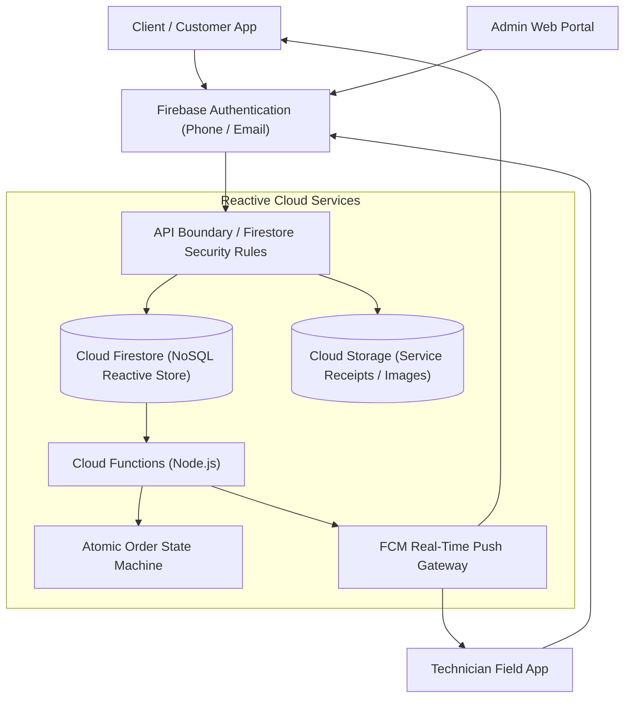

# 📱 Vignesh Agencies — Enterprise Service & Commerce Platform

> **Full-Stack Enterprise Field Service & Commerce Platform**  
> Architected for authorized distribution and maintenance networks. Built with Flutter, Firebase Firestore, and Node.js Cloud Functions featuring atomic transaction guarantees and real-time technician telemetry.

[](https://flutter.dev/)
[](https://dart.dev/)
[](https://firebase.google.com/)
[](https://nodejs.org/)
[](LICENSE)

---

## 🎯 Problem & Solution

* **The Problem:** Regional electrical service and product dealerships manage customer ticket requests, technician dispatches, inventory, and billing through disjointed spreadsheets and manual messaging. Simultaneous checkouts frequently cause inventory race conditions, and lack of live service tracking creates severe operational opacity.
* **The Solution:** A unified enterprise mobile and web platform enabling end-to-end commerce and lifecycle service ticket management. Leverages Flutter for cross-platform responsiveness, Firebase for reactive real-time data sync, and serverless Node.js Cloud Functions to enforce strict ACID state transitions.
* **Core Technical Wins:**
  * **Atomic Transaction Safety:** Implemented Firestore atomic batched writes and Cloud Function verification to eliminate race conditions during inventory reservations.
  * **Role-Based Operational Security (RBAC):** Distinct partitioned interfaces for Administrators, Service Technicians, and Clients.
  * **Sub-Second Live Sync:** Real-time state synchronizations for ticket dispatching and order status updates using Firestore listeners.

---

## 🏗️ Architecture & State Lifecycle



---

## 🚀 Key Features

* **Multi-Tenant Role-Based Access Control (RBAC):**
  - **Client Portal:** Browse catalog, schedule on-site maintenance visits, track live service status, and review order invoices.
  - **Technician Field UI:** View assigned service routes, log diagnostic notes, upload job completion signatures, and claim repair parts.
  - **Admin Command Center:** Monitor technician workload metrics, resolve escalated tickets, and adjust catalog pricing dynamically.
* **Atomic State Machine:** Enforces strict state transitions (`PENDING` $	o$ `CONFIRMED` $	o$ `DISPATCHED` $	o$ `COMPLETED`), auto-reverting locked stock if client sessions expire.
* **Glassmorphic UI Design:** High-polish design language utilizing custom frosted glass cards, fluid typography, and responsive web/mobile viewport adaptation.
* **Hybrid Push Notification System:** Cloud Functions automatically dispatch localized alerts to technicians and customers upon ticket assignment and status changes.

---

## 🛠️ Tech Stack

| Layer | Technologies |
| :--- | :--- |
| **Frontend / Mobile** | Flutter 3.x, Dart, Provider / Riverpod, GoRouter |
| **Backend & Real-Time DB**| Google Cloud Firestore, Firebase Authentication |
| **Serverless Logic** | Node.js, Firebase Cloud Functions |
| **Storage & Messaging** | Firebase Cloud Storage, Firebase Cloud Messaging (FCM) |

---

## 📁 Repository Structure

```
vignesh-agencies/
├── lib/
│   ├── main.dart             # Application initialization & theme setup
│   ├── models/               # Domain data contracts (Order, ServiceTicket, User)
│   ├── screens/              # Modular UI screens (admin, tech, client)
│   ├── services/             # Firestore & Firebase Auth wrapper services
│   └── widgets/              # Reusable UI components (GlassContainer, Badge, Cards)
├── functions/                # Node.js Firebase Cloud Functions (order state machine)
├── web/                      # Web entry points and configurations
├── android/                  # Android native project files
└── pubspec.yaml              # Dart & Flutter dependency manifest
```

---

## ⚡ Quick Start

### 1. Prerequisites
* Flutter SDK (3.10+)
* Dart SDK (3.0+)
* Firebase CLI (`npm install -g firebase-tools`)

### 2. Setup
```bash
git clone https://github.com/Rajasimhareddybolla/vignesh-agencies.git
cd vignesh-agencies
flutter pub get
```

### 3. Run Locally
```bash
# Run on Chrome (Web):
flutter run -d chrome

# Run on Android emulator / device:
flutter run
```

---

## 📄 License

This project is licensed under the [MIT License](LICENSE).

---

## 👨‍💻 Author & Contact

**Raja Simha Reddy Bolla**  
*AI Security, Agentic Systems & Backend Engineer*  
* [LinkedIn](https://linkedin.com/in/raja-simha-reddy-bolla) • [GitHub](https://github.com/Rajasimhareddybolla) • [Email](mailto:rajasimhabolla@gmail.com)
